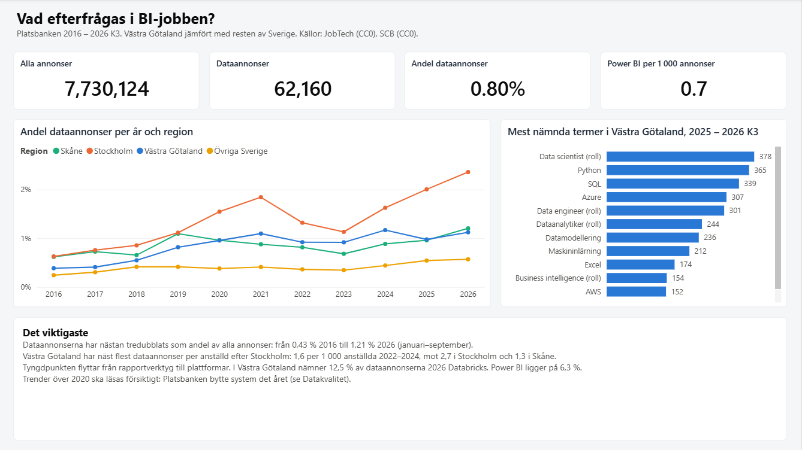
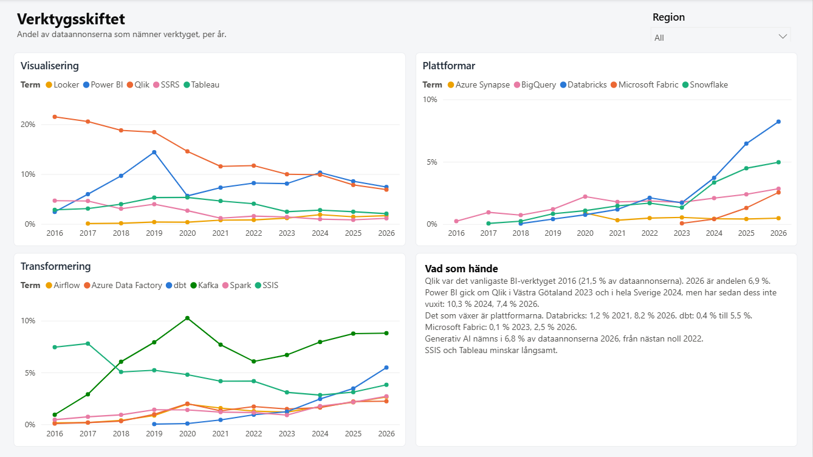
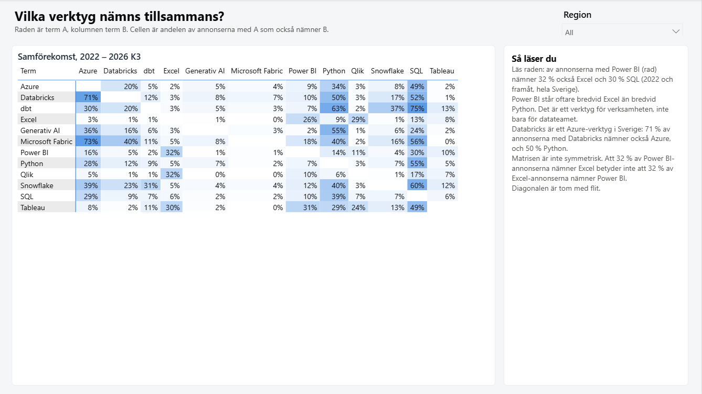
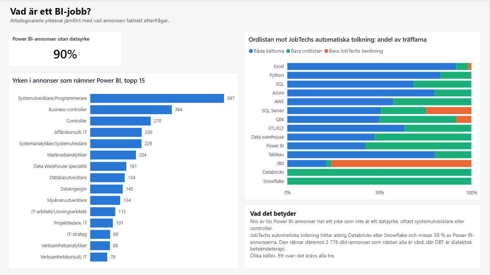
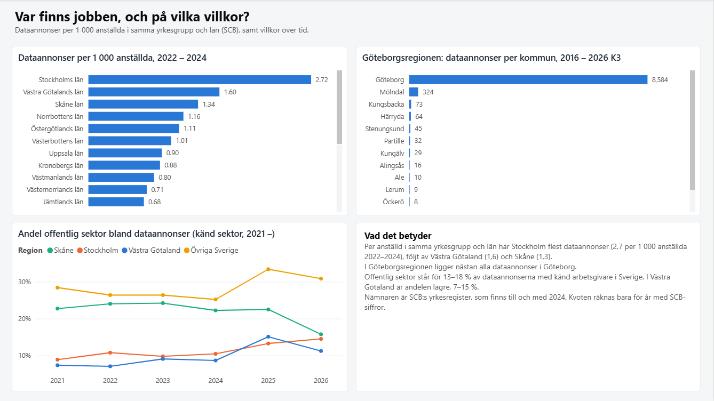
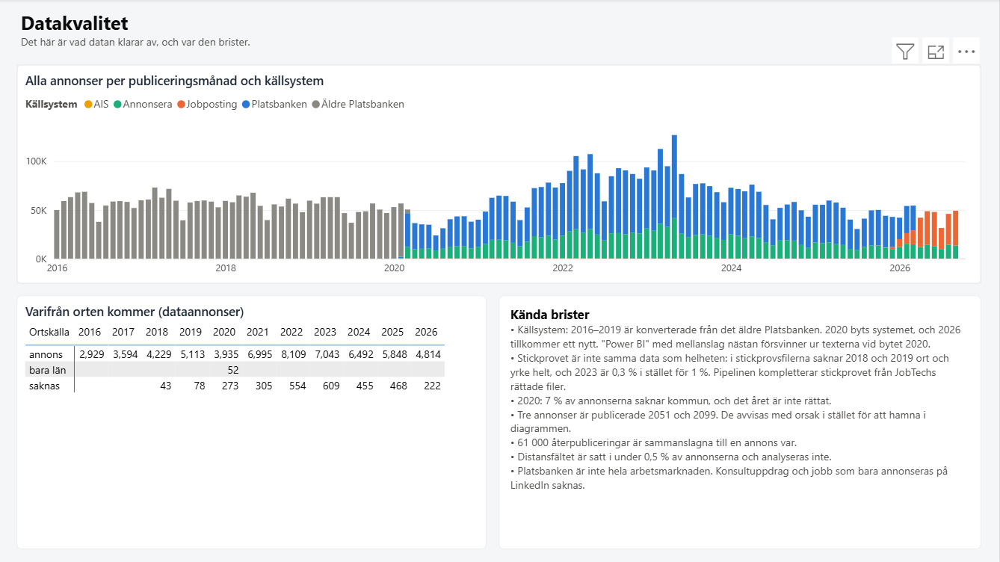
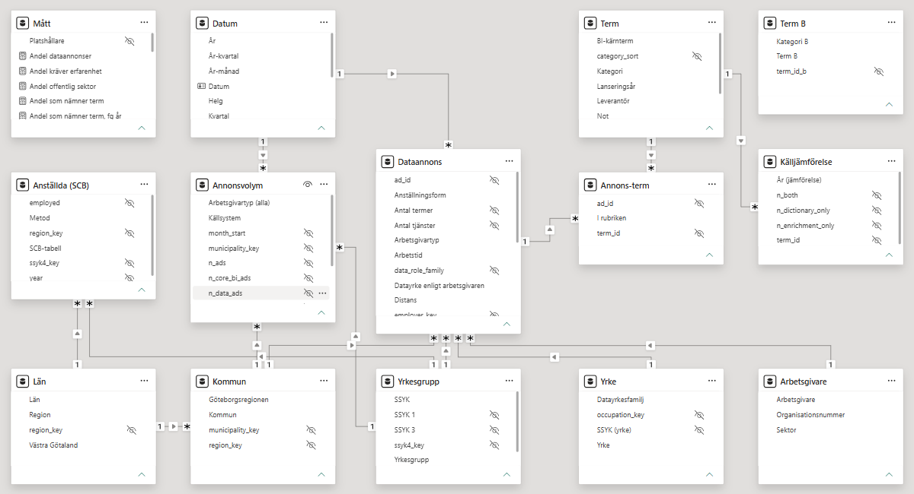

# bi-jobbmarknaden

*[På svenska](README.md)*

What do BI jobs in western Sweden ask for? How has demand for Power BI,
Qlik, Databricks, dbt, Fabric and the other tools changed in job ads since
2016, and how does Västra Götaland (the Gothenburg region) differ from the
rest of Sweden?

The project ingests **all 7.7 million job ads** published on Platsbanken,
the Swedish Public Employment Service's job board, from 2016 to Q3 2026. It
builds a medallion pipeline with dbt and DuckDB, and answers in a Power BI
report whose semantic model is written as code.

All data is open (CC0). No API keys, no personal data, and everything can
be rebuilt from the source.

The report and the data model are in Swedish, because the data, the
audience and the domain are Swedish. Table and measure names are given
with English glosses below.



---

## Different sources. One answer.

The question "what is a BI job?" has three answers, and they disagree:

| Source | How it decides what an ad is about |
|---|---|
| The employer's choice of occupation (SSYK, the Swedish ISCO) | the occupation picked in the posting form |
| JobTech enrichment | the Employment Service's automated interpretation of the ad text |
| The term dictionary in this project | 40 terms with regular expressions, exclusions and context requirements |

The differences between them are the interesting part, not an error to be
cleaned away.

---

## Findings

### 1. Data ads have nearly tripled as a share of all ads

0.43 % of all ads in 2016, 1.21 % in 2026 (January–September). A data ad
is one that mentions a BI tool, a data platform or a BI role, or where the
employer chose a data occupation.

Per employee in the same occupation group and county, **Västra Götaland
has the second highest number of data ads in Sweden**: 1.6 per 1,000
employees in 2022–2024, against 2.7 in Stockholm and 1.3 in Skåne. The
denominator is Statistics Sweden's occupational register. Almost all data
ads in the Gothenburg region are in Gothenburg itself.

### 2. The tool shift: from reporting tools to platforms



| Share of data ads | 2016 | 2021 | 2024 | 2026 |
|---|---|---|---|---|
| Qlik | 21.5 % | 11.6 % | 9.9 % | 6.9 % |
| Power BI | 2.4 % | 7.3 % | 10.3 % | 7.4 % |
| Databricks | – | 1.2 % | 3.7 % | 8.2 % |
| dbt | – | 0.4 % | 2.4 % | 5.5 % |
| Microsoft Fabric | – | – | 0.4 % | 2.5 % |
| Generative AI | – | 0.0 % | 1.9 % | 6.8 % |

Power BI overtook Qlik in Västra Götaland in 2023 and in Sweden as a whole
in 2024, but has not grown since. Platforms are what grow. In Västra
Götaland, 12.5 % of data ads in 2026 mention Databricks, against 8.2 %
nationally, while Power BI is at 6.3 %.

### 3. Power BI sits next to Excel, Databricks next to Azure



Of the ads that mention Power BI, 32 % also mention Excel and 30 % SQL,
but only 14 % Python (2022 onwards). Power BI is a tool for the business,
not just for the data team. 71 % of the ads that mention Databricks also
mention Azure, and 50 % Python.

### 4. Nine in ten Power BI ads are not "data jobs"



In 90 % of the ads that mention Power BI, the employer chose an occupation
that is not a data occupation. The most common are software developer,
business controller and controller.

The third source, JobTech's automated interpretation, sees a different
market:

| Term | Both sources | Dictionary only | JobTech only |
|---|---|---|---|
| Databricks | 0 | 1,535 | 0 |
| Snowflake | 0 | 1,221 | 0 |
| Power BI | 2,200 | 2,982 | 0 |
| dbt | 780 | 92 | **2,776** |

JobTech's interpretation never finds Databricks or Snowflake and misses
58 % of Power BI ads. Of the 2,776 dbt matches that only JobTech has, 95 %
are in healthcare and social work, where DBT means dialectical behaviour
therapy.

### 5. Where the jobs are



The public sector accounts for 13–18 % of data ads with a known employer
in Sweden, but only 7–15 % in Västra Götaland.

---

## DBT means four things

"dbt" was the hardest term in the dictionary, and the one that taught the
most. In job ads it means:

1. **dbt**, the data transformation tool
2. **dialectical behaviour therapy**, in ads for psychologists and therapists
3. **digital breast tomosynthesis**, in ads for radiologists ("dbt-guided biopsies")
4. **a deafblind team** ("dövblindteam"), in an ad for a social worker

The first version of the dictionary excluded therapy. That was enough for
the sample. On the full data, the quality gate found 25 more ads in
healthcare and social work, with the two other meanings and with therapy
written without any of the excluded words ("tydliggörande pedagogik, dbt,
mi"). The term now also requires a data context in the ad (SQL, Python, a
data platform, pipeline, ETL), and the test is green.

The same gate caught "Synapse" before 2019: a company (Synapse Mobile
Networks), a learning management system and a Google team, but not Azure
Synapse. The term now requires "Azure Synapse" or "Synapse Analytics".

---

## Data quality: what the data can and cannot do



**The source systems change.** 2016–2019 is converted from the old
Platsbanken. The system changes during 2020, and a new one is added in
2026. The chart above shows the changes. At the 2020 switch, "Power BI"
written with a space almost disappears from the texts: 608 ads in the 2019
file wrote it that way, 87 in the 2020 file, while "PowerBI" as one word
stays flat. Ads mentioning Power BI drop from 92 in December 2019 to 37 in
January 2020, while the number of data ads stays around 420. Trends across
2020 should be read with that in mind, and the findings above preferably
compare years after the switch.

**The sample is not the same data as the whole.** JobTech publishes a 1 %
sample per year. In the sample files, 2018 and 2019 lack location and
occupation entirely, and the 2023 sample is 0.3 % rather than 1 %. The full
files have location and occupation for 98–99 % of ads. The pipeline
completes the sample from JobTech's corrected metadata files (joined on
`original_id`, 100 % match), so that anyone running only the sample still
gets a working model.

**Three ads are published in 2051 and 2099.** They are in the 2020 file.
The gate "published within the file's period" caught them. They go to
`silver.rejected_ads` with a reason instead of ending up in the charts.

**Other:**

- 60,986 republications are merged, so each ad counts once (`original_id`).
- In 2020, 7 % of ads lack a municipality, and JobTech has not corrected that year.
- The remote work field is set in under 0.5 % of ads and is not analysed.
- Organisation numbers exist only from 2021, so the employer analysis starts there.
- Platsbanken is not the whole labour market. Consulting assignments and jobs advertised only on LinkedIn are missing. The report shows shares and trends, not total demand.

### JobTech's search API could not be used

JobTech has a search API for historical ads that should have made the
files unnecessary. It answered that zero ads mentioned Power BI in 2018,
and 125 in 2024, when the files show 716. The API maps free text to
concepts in a taxonomy instead of searching the text. The files are the
source.

---

## Architecture

```
JobTech, historical ads (zip, 2016 – 2026 Q3, 11 GB) ───────┐
JobTech, corrected locations and occupations 2018 – 2019 ───┼─► landing: files unchanged
Statistics Sweden, occupational register (PxWeb JSON) ──────┘   + manifest (URL, time, size, SHA-256)
                                                                        │
                                             ingest/load_bronze.py      ▼
                                   bronze: Parquet, everything as text, contact fields never read
                                                                        │
                                                         dbt + DuckDB   ▼
                     silver: unique ads, term matches, classification, SCB in long format
                                                                        │
                                                                        ▼
                     gold: star schema with no free text and no personal data
                                                                        │
                                            dbt run-operation export_gold
                                                                        ▼
                     Parquet ─► Power BI (TMDL model and PBIR report, generated as code)
```

**Landing and bronze.** The zip files are stored as they arrived, each
with a row in a manifest. Bronze unpacks them to Parquet without
interpreting anything: dates, codes and flags stay as text, and nested
objects are stored as JSON. 7,791,113 rows in 13 files, 0 errors. One
exception is deliberate: contact fields are never read. Data minimisation
happens at the source, not afterwards.

**Silver** is where decisions are made and can be reviewed: which of
several publications of the same ad counts, where the location comes from,
which terms the ad mentions, which source system it came from and what
kind of employer it is. The ad text is not stored in silver. The
dictionary reads it straight from bronze for the row that silver chose.

**Gold** is the star schema. Nothing in gold can identify a person: a sole
trader's organisation number is their personal identity number, so
employers are only included when they are legal entities.

Everything runs locally on DuckDB. The portfolio already has a Databricks
project ([sweden-power-lakehouse](https://github.com/d3aniq/sweden-power-lakehouse)).
This one shows the same discipline in an environment where anyone can
clone the repo and build the sample with dbt in 14 seconds. The full data
takes just under 10 minutes.

### The dictionary as data

[`dbt/seeds/term_dictionary.csv`](dbt/seeds/term_dictionary.csv) holds 40
terms, each with a regular expression, exclusions and context
requirements. Someone who does not write SQL can change it in a pull
request.

The first version of term matching ran for **over an hour** against 7.7
million ads and never finished. The cause: the patterns were read from a
column, and DuckDB then recompiles the regular expression for every row.
Now dbt reads the dictionary when the model runs and writes each term's
pattern into the SQL as a constant, one query per term. Same matches,
**57 seconds**. Measured on 100,000 ads: 74 seconds against 1.5.

---

## The data model



Three fact tables at different grains, with shared dimensions:

| Table | Grain | Why |
|---|---|---|
| `Dataannons` (data ad) | one unique data ad (62,160) | what the analysis is about, with terms and flags |
| `Annonsvolym` (ad volume) | month × municipality × occupation group × employer type × source system | the denominator: all 7.7 million ads, without the model carrying as many rows |
| `Anställda (SCB)` (employees) | year × county × occupation group | ads per 1,000 employees |

`Källjämförelse` (source comparison: dictionary against JobTech
enrichment, per term and year) is a fourth, small fact table.

Terms are many-to-many against ads. This is solved with the bridge table
`Annons-term` (ad–term), and **without bidirectional filtering**. Filters
on date, location and occupation flow from the dimensions to `Dataannons`
and on to the bridge (one-to-many). Term filters flow from `Term` to the
bridge. The measure counts distinct ads in the bridge:

```dax
Annonser med term = DISTINCTCOUNT('Annons-term'[ad_id])
```

Co-occurrence ("of the ads with Power BI, how many also mention
Databricks?") needs two independent term selections. `Term B` is a
disconnected copy of `Term`, and the measure transfers the selection with
`TREATAS`:

```dax
Samförekomst =
VAR annonserA = VALUES('Annons-term'[ad_id])
VAR termerB   = VALUES('Term B'[term_id_b])
VAR annonserB =
    CALCULATETABLE(
        VALUES('Annons-term'[ad_id]),
        REMOVEFILTERS('Term'),
        TREATAS(termerB, 'Term'[term_id])
    )
VAR sammaTerm = SELECTEDVALUE('Term'[term_id]) = SELECTEDVALUE('Term B'[term_id_b])
RETURN
    IF(NOT sammaTerm, DIVIDE(COUNTROWS(INTERSECT(annonserA, annonserB)), COUNTROWS(annonserA)))
```

The Statistics Sweden table only has years and therefore no relationship
to the date dimension. The measure transfers the selected years with
`TREATAS` and only counts years where the register has figures, so that
2025 and 2026 do not produce a ratio with ads but no employees:

```dax
Dataannonser per 1 000 anställda =
VAR perAr =
    ADDCOLUMNS(VALUES('Datum'[År]), "@annonser", [Dataannonser], "@anstallda", [Anställda])
VAR medScb = FILTER(perAr, NOT ISBLANK([@anstallda]))
RETURN DIVIDE(SUMX(medScb, [@annonser]), SUMX(medScb, [@anstallda])) * 1000
```

Statistics Sweden changed method in 2020 (RAMS for ages 16–64 became BAS
for all ages), and 2020–2021 exist in both series. The difference is
small, 0.5–0.7 %, but visible. The model uses RAMS up to 2019 and BAS
from 2020.

### The report as code

The Power BI report is a PBIP project: the model in TMDL and the report in
PBIR, both as text files in the repo. They are generated by two scripts in
[`powerbi/generator`](powerbi/generator): 14 tables, 14 relationships, 27
DAX measures and 6 pages. Every measure, relationship and visual can be
read and reviewed in a pull request, and a change shows up in `git diff`.
The finding texts in the report live in a separate JSON file.

[`powerbi/BI-jobbmarknaden.pbix`](powerbi/BI-jobbmarknaden.pbix) is the
same report saved with data.

---

## Quality gates

The job should fail loudly rather than deliver quietly wrong data.
`dbt build` runs 73 tests, nine of them custom SQL files in
[`dbt/tests`](dbt/tests) that return the rows that must not exist.

| Check | What it catches |
|---|---|
| Rows in bronze against the load log | that every file was read completely and no row failed |
| Unique ad in silver | that republished ads are not counted twice |
| **Published within the file's period** | ads in the wrong file. Caught 2051 and 2099. |
| Rejected ads are rare | more than 1 in 10,000 means the source or the parsing has changed |
| Location and occupation for at least 90 % per year | the 2018–2019 gap in the sample |
| Counties sum to the national total (SCB) | a cell dropped or misread in the PxWeb response |
| The aggregation balances | that `Annonsvolym` and `Dataannons` agree with silver |
| **No personal data in gold** | personal identity numbers, email addresses and phone numbers, by pattern |
| **Tool before launch** | the wrong word with the right name. Caught Synapse. |
| **dbt in healthcare occupations** | the wrong meaning of an abbreviation. Caught four meanings. |

The ones in bold are based on how the world works, not on data types, and
each has caught something real in the full data that the sample was too
small to show. That they can fail is also tested deliberately: remove the
therapy exclusions from the dictionary and the dbt test fails with 37 ads
already in the sample.

A check that cannot fail is not a check.

### A threshold that moved, and why

Location and occupation were to be present for 95 % of ads every year.
2020 does not make it: 7 % lack a municipality, and JobTech has not
corrected that year. The threshold is now 90 %, and the reason is written
in the test file. The alternative would have been to lower it until
everything turned green without saying anything.

---

## Run it yourself

Requires Python 3.12 or 3.13 (dbt does not support 3.14 yet) and about
25 GB free for full mode. No API keys.

```bash
# The data folder lives outside the repo (not in a synced folder).
# Default: C:/data/bi-jobbmarknaden, or the BI_JOBB_DATA_DIR environment variable.
uv venv --python 3.12 C:/data/bi-jobbmarknaden/venv
uv pip install --python C:/data/bi-jobbmarknaden/venv -r requirements.txt

# 1. Download and load. Without --full: the sample, 1 % per year.
python ingest/download_jobtech.py
python ingest/download_scb.py
python ingest/load_bronze.py

# 2. Build silver and gold and run all tests
cd dbt
dbt deps  --profiles-dir .
dbt build --profiles-dir .

# 3. Export gold to Parquet for Power BI
dbt run-operation export_gold --profiles-dir . --args "{path: 'C:/data/bi-jobbmarknaden/gold'}"
```

Full mode: run `download_jobtech.py --full` and `load_bronze.py --full`,
and set `BI_JOBB_MODE=full` before `dbt build`.

Then open `powerbi/BI-jobbmarknaden.pbip` in Power BI Desktop and refresh.
The `DataFolder` parameter points to `C:\data\bi-jobbmarknaden\gold`. If
you do not want to run the pipeline, point it to `powerbi/data` in the
repo, where gold from the full run is stored as Parquet (11 MB), or just
open the `.pbix` file.

---

## What I would do differently in production

- **Incremental loading.** JobTech publishes one quarter at a time, and
  the pipeline rereads everything. The right approach is to read only new
  files and merge on `original_id`.
- **Scheduling.** Nothing runs the chain automatically. A quarterly job is
  enough.
- **Unit tests for the dictionary.** The gates test against real data, and
  that is how the four meanings of DBT were found. The dictionary should
  also have synthetic cases, one row per known trap, that run without data.
- **The dictionary against a taxonomy.** The terms are hand-picked.
  JobTech's taxonomy has skill concepts with ids, and mapping to them would
  make the comparison with the enrichment exact instead of label-based.
- **One more source.** Platsbanken does not cover the consulting market. A
  comparison with another job ad source would show how large that gap is.

---

## Stack

Python, DuckDB, dbt (dbt-duckdb, dbt_utils), Parquet, Power BI Desktop
(PBIP: TMDL and PBIR).

## Sources

- JobTech Dev, Swedish Public Employment Service: historical job ads, CC0.
  <https://data.jobtechdev.se/annonser/historiska/>
- Documentation and licence:
  <https://gitlab.com/arbetsformedlingen/job-ads/getting-started-code-examples/historical-ads-info>
- Statistics Sweden (SCB), occupational register, tables YREG60, YREG60N
  and YREG60BAS, CC0.
  <https://www.statistikdatabasen.scb.se/pxweb/sv/ssd/START__AM__AM0208__AM0208M/>

The pre-study, written before the code, is in
[`docs/forstudie.md`](docs/forstudie.md) (in Swedish).
