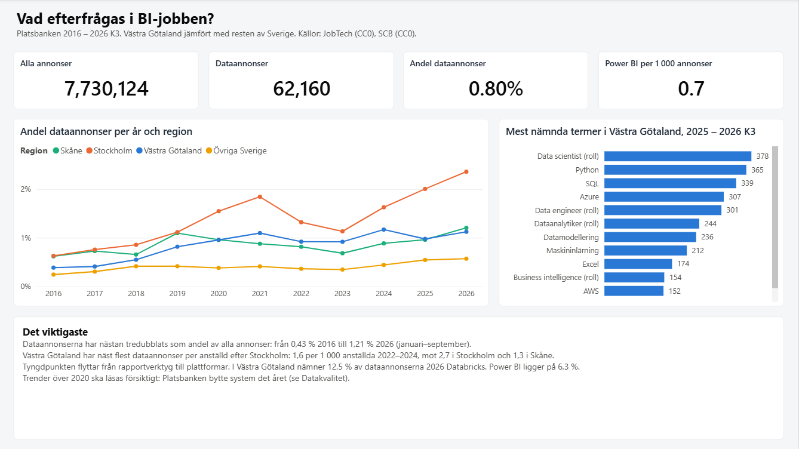
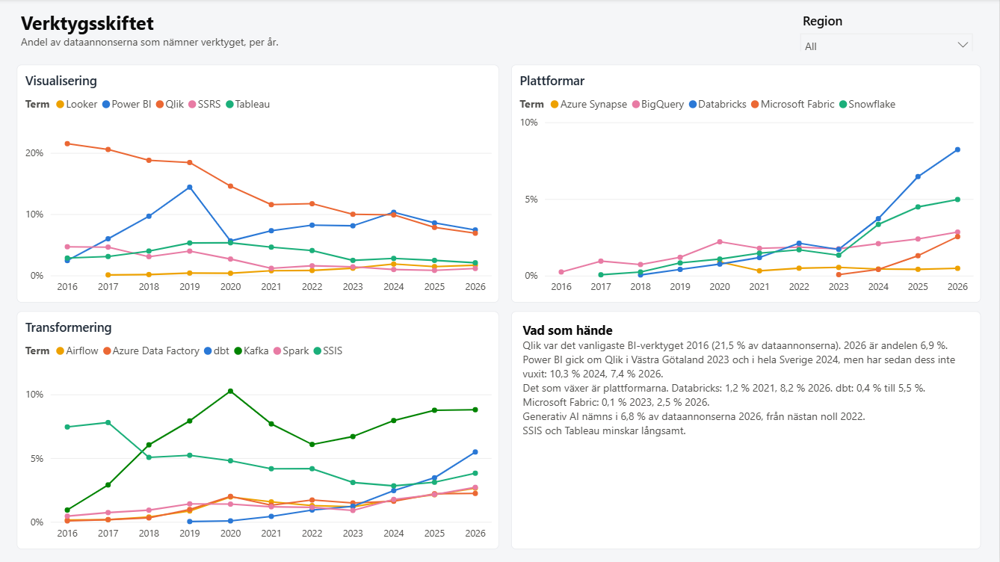
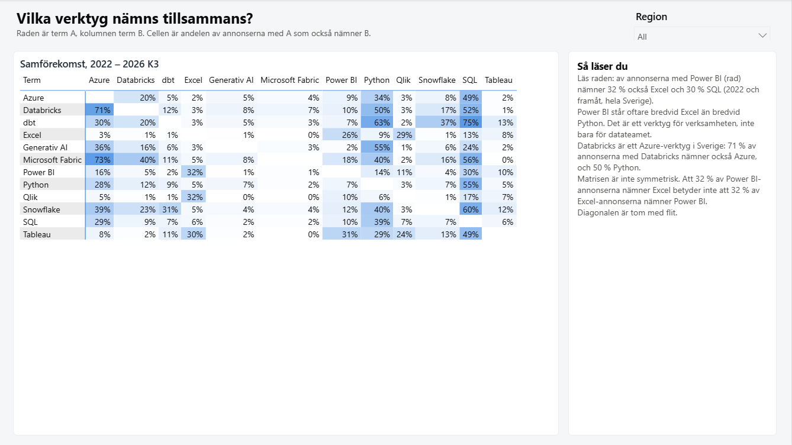
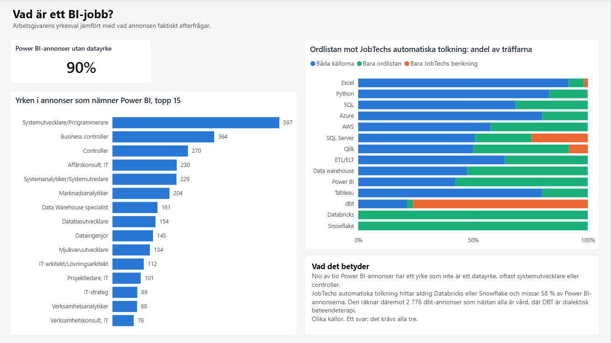
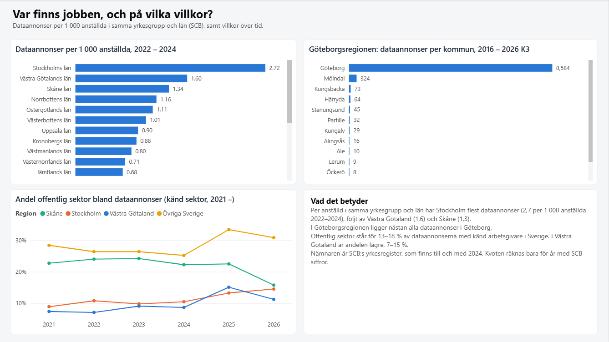
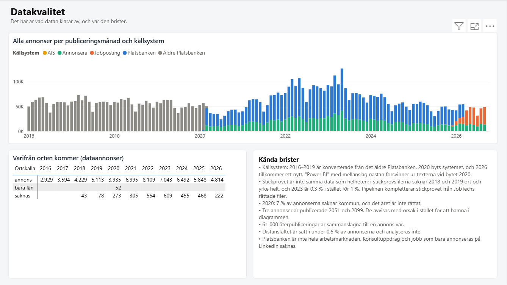
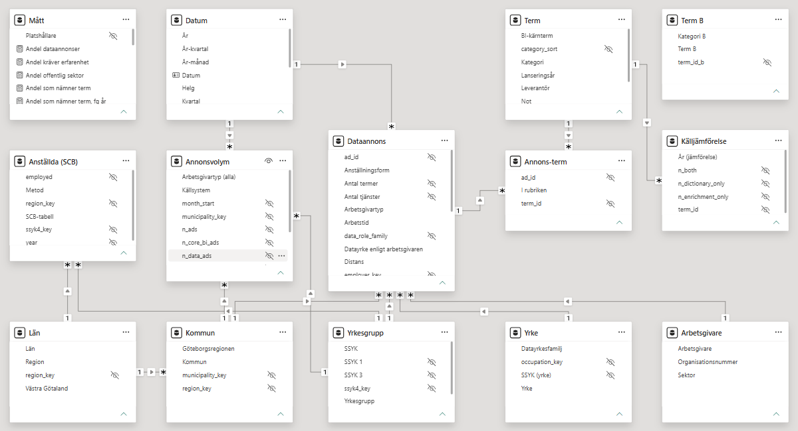

# sweden-bi-job-market

*[In English](README.en.md)*

Vad efterfrågas i BI-jobben i Västsverige? Hur har efterfrågan på Power BI,
Qlik, Databricks, dbt, Fabric och de andra verktygen förändrats i
platsannonserna sedan 2016, och hur skiljer sig Västra Götaland från
resten av Sverige?

Projektet läser in **alla 7,7 miljoner annonser** i Arbetsförmedlingens
Platsbanken från 2016 till och med tredje kvartalet 2026, bygger en
medallion-pipeline med dbt och DuckDB, och svarar i en Power BI-rapport
med en semantisk modell som är skriven som kod.

All data är öppen (CC0). Inga API-nycklar, inga personuppgifter, och allt
kan byggas om från källan.




---

## Olika källor. Ett svar.

Frågan "vad är ett BI-jobb?" har tre svar, och de stämmer inte överens:

| Källa | Hur den avgör vad annonsen handlar om |
|---|---|
| Arbetsgivarens yrkesval (SSYK) | det yrke som valdes i formuläret |
| JobTechs berikning | Arbetsförmedlingens automatiska tolkning av annonstexten |
| Ordlistan i det här projektet | 40 termer med reguljära uttryck, undantag och krav på sammanhang |

Skillnaderna mellan dem är det intressanta, inte ett fel att städa bort.

---

## Fynden

### 1. Dataannonserna har nästan tredubblats som andel

0,43 % av alla annonser 2016, 1,21 % 2026 (januari–september). En
dataannons är en annons som nämner ett BI-verktyg, en dataplattform eller
en BI-roll, eller där arbetsgivaren valt ett datayrke.

Per anställd i samma yrkesgrupp och län har **Västra Götaland näst flest
dataannonser i Sverige**: 1,6 per 1 000 anställda 2022–2024, mot 2,7 i
Stockholm och 1,3 i Skåne. Nämnaren är SCB:s yrkesregister. Nästan alla
annonser i Göteborgsregionen ligger i Göteborg.

### 2. Verktygsskiftet: från rapportverktyg till plattformar



| Andel av dataannonserna | 2016 | 2021 | 2024 | 2026 |
|---|---|---|---|---|
| Qlik | 21,5 % | 11,6 % | 9,9 % | 6,9 % |
| Power BI | 2,4 % | 7,3 % | 10,3 % | 7,4 % |
| Databricks | – | 1,2 % | 3,7 % | 8,2 % |
| dbt | – | 0,4 % | 2,4 % | 5,5 % |
| Microsoft Fabric | – | – | 0,4 % | 2,5 % |
| Generativ AI | – | 0,0 % | 1,9 % | 6,8 % |

Power BI gick om Qlik i Västra Götaland 2023 och i hela Sverige 2024, men
har inte vuxit sedan dess. Det som växer är plattformarna. I Västra
Götaland nämner 12,5 % av dataannonserna 2026 Databricks, mot 8,2 % i
riket, medan Power BI ligger på 6,3 %.

### 3. Power BI står bredvid Excel, Databricks bredvid Azure



Av annonserna som nämner Power BI nämner 32 % också Excel och 30 % SQL,
men bara 14 % Python (2022 och framåt). Power BI är ett verktyg för
verksamheten, inte bara för datateamet. 71 % av annonserna med Databricks
nämner Azure, och 50 % Python.

### 4. Nio av tio Power BI-annonser är inte "datajobb"



I 90 % av annonserna som nämner Power BI har arbetsgivaren valt ett yrke
som inte är ett datayrke. Vanligast är systemutvecklare, business
controller och controller.

Den tredje källan, JobTechs automatiska tolkning, ser en annan marknad:

| Term | Båda källorna | Bara ordlistan | Bara JobTech |
|---|---|---|---|
| Databricks | 0 | 1 535 | 0 |
| Snowflake | 0 | 1 221 | 0 |
| Power BI | 2 200 | 2 982 | 0 |
| dbt | 780 | 92 | **2 776** |

JobTechs tolkning hittar aldrig Databricks eller Snowflake och missar 58 %
av Power BI-annonserna. De 2 776 dbt-träffar som bara JobTech har ligger
till 95 % inom vård och socialt arbete, där DBT betyder dialektisk
beteendeterapi.

### 5. Var jobben finns



Offentlig sektor står för 13–18 % av dataannonserna med känd arbetsgivare
i Sverige, men bara 7–15 % i Västra Götaland.

---

## DBT betyder fyra saker

Ordet "dbt" var den svåraste termen i ordlistan, och den som lärde mest.
I annonserna betyder det:

1. **dbt**, verktyget för datatransformering
2. **dialektisk beteendeterapi**, i annonser för psykologer och behandlare
3. **digital bröst-tomosyntes**, i annonser för röntgenläkare ("dbt-guidade biopsier")
4. **ett dövblindteam**, i en kuratorsannons

Den första versionen av ordlistan undantog terapi. Det räckte för
stickprovet. På full data hittade kvalitetsgrinden 25 annonser till inom
vård och socialt arbete, med de två andra betydelserna och med terapi
utan något av undantagsorden ("tydliggörande pedagogik, dbt, mi"). Nu
kräver termen också datasammanhang i annonsen (SQL, Python, en
dataplattform, pipeline, ETL), och testet är grönt.

Samma grind fångade "Synapse" före 2019: ett företag (Synapse Mobile
Networks), ett utbildningssystem och ett Google-team, men inte Azure
Synapse. Termen kräver nu "Azure Synapse" eller "Synapse Analytics".

---

## Datakvalitet: vad datan klarar av, och var den brister



**Källsystemen byts.** 2016–2019 är konverterade från det äldre
Platsbanken. Under 2020 byts systemet, och 2026 tillkommer ett nytt.
Diagrammet ovan visar bytena. Vid bytet 2020 försvinner "Power BI" med
mellanslag nästan helt ur texterna: 608 annonser i 2019 års fil skrev så,
87 i 2020 års fil, medan "PowerBI" i ett ord ligger stilla. Annonser som nämner Power
BI faller från 92 i december 2019 till 37 i januari 2020, medan antalet
dataannonser ligger kvar kring 420. Trender över 2020 ska läsas med det i
minnet, och fynden ovan jämför helst år efter bytet.

**Stickprovet är inte samma data som helheten.** JobTech publicerar ett
stickprov på 1 % per år. I stickprovsfilerna saknar 2018 och 2019 ort och
yrke helt, och stickprovet för 2023 är 0,3 % i stället för 1 %. De
fullständiga filerna har ort och yrke för 98–99 % av annonserna. Pipelinen
kompletterar stickprovet från JobTechs rättade metadatafiler (koppling på
`original_id`, 100 % träff), så att den som bara kör stickprovet ändå får
en fungerande modell.

**Tre annonser är publicerade 2051 och 2099.** De ligger i 2020 års fil.
Grinden "publicerad inom filens period" fångade dem. De går till
`silver.rejected_ads` med orsak i stället för att hamna i diagrammen.

**Övrigt:**

- 60 986 återpubliceringar är sammanslagna, så att varje annons räknas en gång (`original_id`).
- 2020 saknar 7 % av annonserna kommun, och JobTech har inte rättat det året.
- Distansfältet är satt i under 0,5 % av annonserna och analyseras inte.
- Organisationsnummer finns först från 2021, så arbetsgivaranalysen börjar där.
- Platsbanken är inte hela arbetsmarknaden. Konsultuppdrag och jobb som bara annonseras på LinkedIn saknas. Rapporten visar andelar och trender, inte den totala efterfrågan.

### JobTechs sök-API gick inte att använda

JobTech har ett sök-API för historiska annonser som borde ha gjort
filerna onödiga. Det svarade att noll annonser nämnde Power BI 2018, och
125 annonser 2024, när filerna visar 716. API:et tolkar fritext till
begrepp i en taxonomi i stället för att söka i texten. Filerna är källan.

---

## Arkitektur

```
JobTech, historiska annonser (zip, 2016 – 2026 K3, 11 GB) ──┐
JobTech, rättade orter och yrken 2018 – 2019 ───────────────┼─► landing: filerna oförändrade
SCB, yrkesregistret (PxWeb JSON) ───────────────────────────┘   + manifest (URL, tid, storlek, SHA-256)
                                                                        │
                                             ingest/load_bronze.py      ▼
                                   bronze: Parquet, allt som text, kontaktfälten lästa aldrig
                                                                        │
                                                         dbt + DuckDB   ▼
                     silver: unika annonser, ordträffar, klassning, SCB i långt format
                                                                        │
                                                                        ▼
                     gold: stjärnschema utan text och utan personuppgifter
                                                                        │
                                            dbt run-operation export_gold
                                                                        ▼
                     Parquet ─► Power BI (TMDL-modell och PBIR-rapport, genererade som kod)
```

**Landing och bronze.** Zip-filerna sparas som de kom, med en rad var i
ett manifest. Bronze packar upp dem till Parquet utan att tolka något:
datum, koder och flaggor står kvar som text, och nästlade objekt sparas
som JSON. 7 791 113 rader i 13 filer, 0 fel. Ett undantag görs med flit:
kontaktfälten läses aldrig in. Dataminimering sker vid källan, inte i
efterhand.

**Silver** är där besluten fattas och kan granskas: vilken av flera
publiceringar av samma annons som gäller, var orten kommer ifrån, vilka
ord annonsen nämner, vilket källsystem den kom från och vilken sorts
arbetsgivare det är. Annonstexten lagras inte i silver. Ordlistan läser
den direkt från bronze för den rad som silver valt.

**Gold** är stjärnschemat. Inget i gold kan peka ut en person: en
enskild näringsidkares organisationsnummer är personnumret, så
arbetsgivare tas bara med när det är en juridisk person.

Allt körs lokalt med DuckDB. Portfolion har redan ett Databricks-projekt
([sweden-power-lakehouse](https://github.com/d3aniq/sweden-power-lakehouse)).
Det här visar samma disciplin i en miljö där vem som helst kan klona repot
och bygga stickprovet med dbt på 14 sekunder. Full data tar knappt 10 minuter.

### Ordlistan som data

[`dbt/seeds/term_dictionary.csv`](dbt/seeds/term_dictionary.csv) har 40
termer, var och en med ett reguljärt uttryck, undantag och krav på
sammanhang. Den kan ändras i en pull request av någon som inte skriver
SQL.

Den första versionen av ordsökningen tog **över en timme** mot 7,7
miljoner annonser och blev aldrig klar. Orsaken: mönstren lästes från en
kolumn, och då kompilerar DuckDB om det reguljära uttrycket för varje
rad. Nu läser dbt ordlistan när modellen körs och skriver in varje terms
mönster som en konstant, med en fråga per term. Samma träffar, **57
sekunder**. Uppmätt på 100 000 annonser: 74 sekunder mot 1,5.

---

## Datamodellen



Tre faktatabeller på olika korn, med delade dimensioner:

| Tabell | Korn | Varför |
|---|---|---|
| `Dataannons` | en unik dataannons (62 160) | det analysen handlar om, med villkor och flaggor |
| `Annonsvolym` | månad × kommun × yrkesgrupp × arbetsgivartyp × källsystem | nämnaren: alla 7,7 miljoner annonser, utan att modellen bär lika många rader |
| `Anställda (SCB)` | år × län × yrkesgrupp | annonser per 1 000 anställda |

`Källjämförelse` (ordlistan mot JobTechs berikning, per term och år) är en
fjärde, liten faktatabell.

Termerna är många-till-många mot annonserna. Det löses med bryggtabellen
`Annons-term`, och **utan dubbelriktad filtrering**. Filter på datum, ort
och yrke går från dimensionerna till `Dataannons` och vidare till bryggan
(en-till-många). Termfilter går från `Term` till bryggan. Måttet räknar
unika annonser i bryggan:

```dax
Annonser med term = DISTINCTCOUNT('Annons-term'[ad_id])
```

Samförekomst ("av annonserna med Power BI, hur många nämner också
Databricks?") kräver två oberoende termval. `Term B` är en frikopplad
kopia av `Term`, och måttet för över valet med `TREATAS`:

```dax
Samförekomst =
VAR annonserA = VALUES('Annons-term'[ad_id])
VAR termerB   = VALUES('Term B'[term_id_b])
VAR annonserB =
    CALCULATETABLE(
        VALUES('Annons-term'[ad_id]),
        REMOVEFILTERS('Term'),
        TREATAS(termerB, 'Term'[term_id])
    )
VAR sammaTerm = SELECTEDVALUE('Term'[term_id]) = SELECTEDVALUE('Term B'[term_id_b])
RETURN
    IF(NOT sammaTerm, DIVIDE(COUNTROWS(INTERSECT(annonserA, annonserB)), COUNTROWS(annonserA)))
```

SCB-tabellen har bara år och därför ingen relation till datumdimensionen.
Måttet för över valda år med `TREATAS` och räknar bara år där SCB har
siffror, så att 2025 och 2026 inte ger en kvot med annonser men utan
anställda:

```dax
Dataannonser per 1 000 anställda =
VAR perAr =
    ADDCOLUMNS(VALUES('Datum'[År]), "@annonser", [Dataannonser], "@anstallda", [Anställda])
VAR medScb = FILTER(perAr, NOT ISBLANK([@anstallda]))
RETURN DIVIDE(SUMX(medScb, [@annonser]), SUMX(medScb, [@anstallda])) * 1000
```

SCB bytte metod 2020 (RAMS för 16–64 år blev BAS för alla åldrar), och
2020–2021 finns i båda serierna. Skillnaden är liten, 0,5–0,7 %, men
syns. Modellen använder RAMS till och med 2019 och BAS därefter.

### Rapporten som kod

Power BI-rapporten är ett PBIP-projekt: modellen i TMDL och rapporten i
PBIR, båda som textfiler i repot. De genereras av två skript i
[`powerbi/generator`](powerbi/generator): 14 tabeller, 14 relationer, 27
DAX-mått och 6 sidor. Varje mått, relation och visualisering går att läsa
och granska i en pull request, och en ändring syns i `git diff`.
Fyndtexterna i rapporten ligger i en egen JSON-fil.

[`powerbi/BI-jobbmarknaden.pbix`](powerbi/BI-jobbmarknaden.pbix) är samma
rapport sparad med data.

---

## Kvalitetsgrindar

Jobbet ska fallera högt hellre än att leverera tyst felaktig data.
`dbt build` kör 73 tester, varav nio är egna SQL-filer i
[`dbt/tests`](dbt/tests) som returnerar de rader som inte får finnas.

| Kontroll | Vad den fångar |
|---|---|
| Rader i bronze mot inläsningsloggen | att varje fil lästes in helt och att ingen rad misslyckades |
| Unik annons i silver | att återpublicerade annonser inte räknas två gånger |
| **Publicerad inom filens period** | annonser i fel fil. Fångade 2051 och 2099. |
| Avvisade annonser är få | fler än 1 på 10 000 betyder att källan eller tolkningen har ändrats |
| Ort och yrke för minst 90 % per år | luckan 2018–2019 i stickprovet |
| Länen summerar till riket (SCB) | att en cell tappats eller tolkats fel i PxWeb-svaret |
| Aggregeringen balanserar | att `Annonsvolym` och `Dataannons` stämmer med silver |
| **Ingen personuppgift i gold** | personnummer, e-postadresser och telefonnummer, med mönster |
| **Verktyg före lansering** | fel ord med rätt namn. Fångade Synapse. |
| **dbt i vårdyrken** | fel betydelse av en förkortning. Fångade fyra betydelser. |

De som är markerade bygger på hur världen ser ut, inte på datatyper, och
var och en har fångat något verkligt i full data som stickprovet var för
litet för att visa. Att de kan fallera är också testat med flit: tas
undantagen för terapi bort ur ordlistan fallerar dbt-testet med 37
annonser redan i stickprovet.

En kontroll som inte kan fallera är ingen kontroll.

### En tröskel som flyttades, och varför

Ort och yrke skulle finnas för 95 % av annonserna varje år. 2020 klarar
det inte: 7 % saknar kommun, och JobTech har inte rättat det året.
Tröskeln är nu 90 %, och skälet står i testfilen. Alternativet hade varit
att sänka den tills allt blev grönt utan att säga något.

---

## Kör själv

Kräver Python 3.12 eller 3.13 (dbt stöder inte 3.14 än) och cirka 25 GB
ledigt för fullt läge. Inga API-nycklar.

```bash
# Datamappen ligger utanför repot (inte i en mapp som synkas).
# Standard: C:/data/bi-jobbmarknaden, eller miljövariabeln BI_JOBB_DATA_DIR.
uv venv --python 3.12 C:/data/bi-jobbmarknaden/venv
uv pip install --python C:/data/bi-jobbmarknaden/venv -r requirements.txt

# 1. Hämta och läs in. Utan --full: stickprovet, 1 % per år.
python ingest/download_jobtech.py
python ingest/download_scb.py
python ingest/load_bronze.py

# 2. Bygg silver och gold och kör alla tester
cd dbt
dbt deps  --profiles-dir .
dbt build --profiles-dir .

# 3. Exportera gold till Parquet för Power BI
dbt run-operation export_gold --profiles-dir . --args "{path: 'C:/data/bi-jobbmarknaden/gold'}"
```

Fullt läge: kör `download_jobtech.py --full` och `load_bronze.py --full`,
och sätt `BI_JOBB_MODE=full` innan `dbt build`.

Öppna sedan `powerbi/BI-jobbmarknaden.pbip` i Power BI Desktop och
uppdatera. Parametern `DataFolder` pekar på `C:\data\bi-jobbmarknaden\gold`.
Den som inte vill köra pipelinen kan peka den på `powerbi/data` i repot,
där gold från den fulla körningen ligger som Parquet (11 MB), eller bara
öppna `.pbix`-filen.

---

## Det jag skulle göra annorlunda i produktion

- **Inkrementell inläsning.** JobTech publicerar ett kvartal i taget, och
  pipelinen läser om allt. Rätt vore att bara läsa nya filer och slå ihop
  på `original_id`.
- **Schemaläggning.** Inget kör kedjan automatiskt. Ett kvartalsjobb räcker.
- **Enhetstester av ordlistan.** Grindarna testar mot riktig data, och det
  var så de fyra betydelserna av DBT hittades. Ordlistan borde också ha
  syntetiska fall, en rad per känd fälla, som körs utan data.
- **Ordlistan mot en taxonomi.** Termerna är handplockade. JobTechs
  taxonomi har kompetensbegrepp med id, och en mappning dit skulle göra
  jämförelsen med berikningen exakt i stället för via etiketter.
- **En källa till.** Platsbanken täcker inte konsultmarknaden. En
  jämförelse med en annan annonskälla skulle visa hur stor luckan är.

---

## Stack

Python, DuckDB, dbt (dbt-duckdb, dbt_utils), Parquet, Power BI Desktop
(PBIP: TMDL och PBIR).

## Källor

- JobTech Dev, Arbetsförmedlingen: historiska annonser, CC0.
  <https://data.jobtechdev.se/annonser/historiska/>
- Dokumentation och licens:
  <https://gitlab.com/arbetsformedlingen/job-ads/getting-started-code-examples/historical-ads-info>
- SCB, yrkesregistret, tabellerna YREG60, YREG60N och YREG60BAS, CC0.
  <https://www.statistikdatabasen.scb.se/pxweb/sv/ssd/START__AM__AM0208__AM0208M/>

Förstudien, skriven före koden, finns i [`docs/forstudie.md`](docs/forstudie.md).
